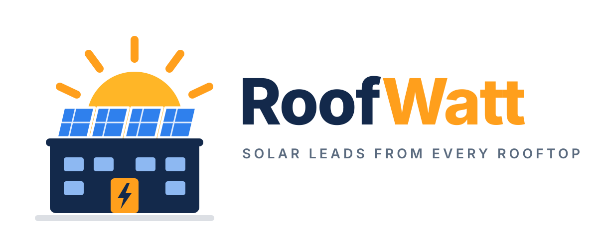
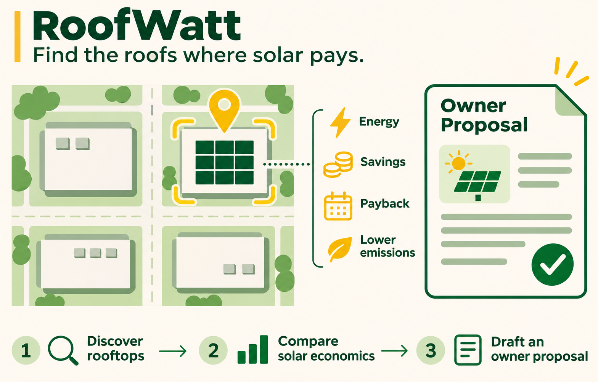

<p align="center">
  
</p>

<p align="center"><b>Find the roofs where solar pays.</b></p>

<p align="center">
  Built at <b>HackPrinceton Fall 2026</b> · Live demo: <a href="https://roofwatt.streamlit.app">roofwatt.streamlit.app</a>
</p>

---

RoofWatt is an AI agent that ranks commercial rooftops in Houston by their solar economics. For each building it
estimates energy, savings, payback and CO₂ avoided, then drafts a proposal letter to the owner of the best one.

Ask it in plain English:

> *"Find the 10 office buildings in Houston with the best solar payback and draft a pitch for the top one."*

The agent plans the work, calls its tools, screens all 185 Houston office buildings in the CoStar extract (171 are
big enough to rank), shows the top 10 on a map with an aerial image of the roof, and writes the letter. Every
number in the answer comes from a tool, not from the language model.



## Why

Commercial roofs are large, flat and mostly empty. Solar installers, brokers and city sustainability offices know
the opportunity is there, but finding the buildings where solar actually pays off means combining property records,
roof size, local sunlight, electricity prices, installation costs and tax credits for each building. RoofWatt does
that screening in about a minute and turns the result into a first message to the owner.

## Hackathon tracks

| Track | How RoofWatt fits |
| --- | --- |
| **Sustainability** (main) | Points solar investment at the roofs with the fastest payback and reports the CO₂ each one avoids |
| **CoStar: Inside and Out, AI for the Built World** | Combines two data layers: CoStar building records and Vexcel aerial imagery. The agent plans, screens, ranks and acts |
| **Amazon: Best Practical AI Innovation** | An installer could use it on Monday to build a lead list and a first pitch |
| **LangChain: Best use of deepagents** | The agent is built with LangChain `deepagents` and its tool trace is shown live in the app |

## Features

- **Natural-language search** or a structured form (city, property type, minimum size, number of results).
- **Agent with seven tools**: `searchBuildings`, `getBuilding`, `analyzeRoof`, `estimateSolar`, `computeFinancials`,
  `rankBuildings`, `getRoofImage`. `rankBuildings` screens every matching building in code, so the ranking does not
  depend on the model.
- **Live tool trace**: each step the agent takes is shown while it runs.
- **Results**: KPIs, a ranked table and a 2D map (best rank in green through lowest in red).
- **Building page**: Vexcel aerial image of the roof plus the full energy and finance breakdown.
- **What-if**: change the assumptions (for example the usable roof share, 0.30 to 1.00) and the ranking is
  recalculated without calling the agent again.
- **Proposal letter** to the owner of the top building, with Copy and Download.
- **Assumptions page**: every number the model uses, with its source.
- **Two AI engines**: Cloud (Gemini) or Local (any model in Ollama), switchable from the sidebar.
- **Light and dark appearance** (Catppuccin Latte / Mocha), following the system setting.

## How it works

```text
Question (Streamlit)
   │
   ▼
Agent (LangChain deepagents · Gemini or a local Ollama model)
   ├─ searchBuildings / getBuilding  → CoStar extract (local JSONL)
   ├─ analyzeRoof                    → usable roof area from CoStar floor areas
   ├─ estimateSolar                  → NREL PVWatts v8 (annual kWh)
   ├─ computeFinancials              → savings, cost, payback, CO₂ (pure Python)
   ├─ rankBuildings                  → runs the three steps above for every match and ranks them
   └─ getRoofImage                   → Vexcel aerial image of the roof
   │
   ▼
Ranked table · map · roof image · proposal letter
```

### The model

```text
footprint_m2   = min(typical floor ft², gross ft² / stories) × 0.092903
usable_roof_m2 = footprint_m2 × 0.6                          (usable share of the roof)
system_kw      = usable_roof_m2 × 0.1477                     (0.211 kW/m² module × 0.70 module-to-roof ratio)
annual_kwh     = PVWatts(lat, lon, system_kw, tilt 15°, azimuth 180°, losses 14%)
savings_usd    = annual_kwh × $0.0856/kWh
capex_usd      = system_kw × 1000 × cost per watt for that system size
net_capex_usd  = capex_usd × (1 − 0.30)                      (federal ITC)
payback_yr     = net_capex_usd / savings_usd
co2_t_per_yr   = annual_kwh × 0.3329 kg/kWh / 1000
```

Buildings under 50 kW are dropped. The rest are sorted by payback (shortest first), with CO₂ avoided breaking ties.
Every rank is unique.

### Data sources and assumptions

| Input | Value | Source |
| --- | --- | --- |
| Building records | type, floor area, stories, location, owner | CoStar hackathon extract |
| Roof imagery | aerial orthophoto | Vexcel |
| Annual energy | per building | NREL PVWatts v8 |
| Module power density | 0.211 kW/m² | DOE, *Solar PV System Cost Benchmarks*, 2025 Q1 |
| Module-to-roof ratio, tilt, azimuth | 0.70, 15°, 180° | Gagnon et al. 2016, NREL/TP-6A20-65298, Table 1 |
| Electricity price | $0.0856/kWh | EIA *Electric Power Annual*, Table 2.10 (Texas commercial, 2025) |
| Installed cost | $3.60/W down to $1.90/W, by system size | LBNL *Distributed Solar & Storage 2026 Data Update* |
| Tax credit | 30% | IRC §48E clean electricity ITC |
| Grid emissions | 733.862 lb CO₂/MWh | EPA eGRID2023, ERCOT subregion |
| Usable roof share | 0.6 | Assumption (no source); adjustable on the Assumptions page |

Full citations are in [config.py](config.py) and on the app's Assumptions page.

**Limits.** The ITC needs the system placed in service by 2027-12-31 under current law. The electricity price is
an all-in average (solar mostly offsets energy charges, not demand charges). The eGRID rate is an average, not a
marginal rate. Installed costs are national medians. Roofs with irregular shapes (V or X plans) can be overestimated
by about 20%. These are screening estimates, not a site assessment.

## Run it locally

You need Python 3.13+ and [Git LFS](https://git-lfs.com) (the CoStar extract in `costar-kit/data/*.jsonl` is stored with LFS).

```bash
brew install git-lfs && git lfs install      # once, before cloning
git clone https://github.com/DungLe-304/roofwatt.git && cd roofwatt

python3 -m venv .venv && source .venv/bin/activate
pip install -r requirements.txt              # or: uv sync
cp .env.example .env                         # then add your keys (below)

streamlit run app.py
```

### API keys (`.env`)

| Key | Used for | Get one |
| --- | --- | --- |
| `NLR_API_KEY` | PVWatts energy estimates | free at [developer.nlr.gov/signup](https://developer.nlr.gov/signup/) |
| `GOOGLE_API_KEY` | Cloud AI engine (Gemini) | Google AI Studio |
| `VEXCEL_API_KEY` | Roof images | Vexcel (hackathon access) |

PVWatts answers for the Houston demo are already cached in `cache/pvwatts/`, so the ranking works without new
PVWatts calls. Never commit `.env`.

### AI engine: Cloud or Local

The sidebar switch picks the language model. Both engines use the same tools and prompt.

- **Cloud** (default): Gemini through `GOOGLE_API_KEY`. If the free quota runs out, the run finishes on the local
  model and the switch moves to Local. Picking Cloud again retries Gemini.
- **Local**: any model served by [Ollama](https://ollama.com) on this computer. The sidebar lists every pulled model;
  `qwen3.5:4b` is the default and runs the demo query in about 45 seconds.

```bash
brew install ollama          # or the installer from ollama.com
ollama serve                 # leave running (the macOS app starts it for you)
ollama pull qwen3.5:4b
```

To use Ollama on another machine, set `ollamaHost=http://<host>:11434` in `.env`. `localModelName` changes the
default local model. Small local models follow the tool rules less reliably than Gemini.

### Before a demo

```bash
python tools/prefetch_images.py --top 20     # cache Vexcel roof images for the top 20 buildings
pytest -q                                    # 120 tests, no network or LLM needed
```

If an agent run fails, the app shows the last good run (saved in `cache/ui/last_run.json`).

## Deployment

The live app runs on Streamlit Community Cloud from the `main` branch. Keys go in the app's **Secrets** as root-level
TOML keys, which become environment variables. Only the Cloud engine works there, since there is no Ollama server.

## Project structure

```text
app.py               Streamlit entry: Analyze, Results, Building, Proposal, Assumptions pages
config.py            every assumption with its source, plus app settings
agent/               system prompt, Cloud/Local engines, tools, reading tool results
data/                CoStar adapter, Vexcel imagery, OSM footprints, file cache
models/              data contracts, roof, solar (PVWatts) and finance calculations
ui/                  page components, map, what-if, letter, styles and palette
tools/               prefetch_images.py (fill the Vexcel image cache before a demo)
tests/               pytest and Streamlit AppTest with fake agents
docs/PROJECT_PLAN.md full project plan
costar-kit/          CoStar data kit: data/*.jsonl (Git LFS), CSVs, schemas/, docs (index.md, models/*.md)
```

## Tech stack

Python 3.13 · LangChain `deepagents` · Gemini / Ollama · Streamlit + pydeck · NREL PVWatts v8 · Vexcel · CoStar ·
pytest

## Team

- **Dung Le (Tony Le)**: data, models, finance, UI
- **Khoa Nguyen**: APIs, agent, backend

## Credits

Building data from CoStar and aerial imagery from Vexcel, provided for HackPrinceton Fall 2026. Map tiles by CARTO,
building footprints from OpenStreetMap contributors. Font: CaskaydiaCove Nerd Font Mono (SIL Open Font License,
see [static/fonts/LICENSE](static/fonts/LICENSE)).
